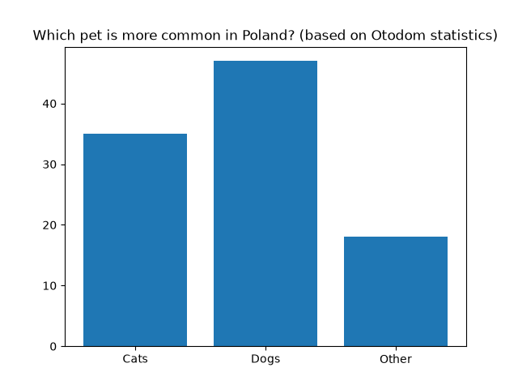

# Bar Chart

Documentation for the `bar` chart module in Analitika.

## Configuration Options

Required fields are **bolded**.

### Top-level configuration (`BaseConfig`)

- **`type`** (`string`) — Chart type selector. Must be set to `"bar"` to use the bar chart module.
- **`module_config`** (`object`) — Object containing the bar chart-specific configuration options described below.

### Module configuration (`BarConfig`)

- **`categories`** (`list[string]`) — Labels for each bar along the x-axis. Each label corresponds to the value at the same index in `values`.
- **`values`** (`list[float]`) — Numeric values determining the height of each bar. The order and length should match `categories`.
- **`title`** (`string`) — Title displayed at the top of the chart.

## Full Configuration Model (JSON)

```json
{
  "type": "bar",
  "module_config": {
    "categories": ["string"],
    "values": [0.0],
    "title": "string"
  }
}
```

## Example

The following [config.json](config.json) demonstrates a complete configuration:

```json
{
  "type": "bar",
  "module_config": {
    "categories": [
      "Cats",
      "Dogs",
      "Other"
    ],
    "values": [
      35.0,
      47.0,
      18.0
    ],
    "title": "Which pet is more common in Poland? (based on Otodom statistics)"
  }
}
```

To generate the chart:

```bash
python main.py examples/bar/config.json -o examples/bar/preview.png
```

### Preview


