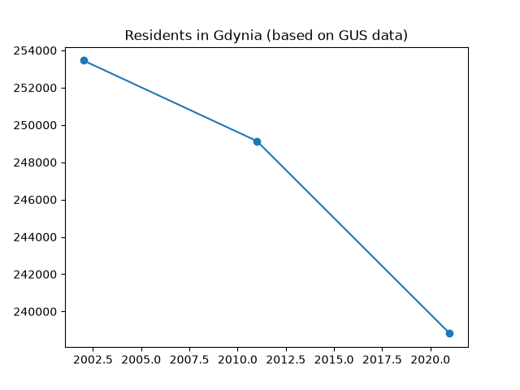

# Line Chart

Documentation for the `line` chart module in Analitika.

## Configuration Options

Required fields are **bolded**.

### Top-level configuration (`BaseConfig`)

- **`type`** (`string`) — Chart type selector. Must be set to `"line"` to use the line chart module.
- **`module_config`** (`object`) — Object containing the line chart-specific configuration options described below.

### Module configuration (`LineConfig`)

- **`x`** (`list[float]`) — Numeric values for data points along the x-axis. Each value corresponds to the value at the same index in `y`.
- **`y`** (`list[float]`) — Numeric values for data points along the y-axis. The order and length should match `x`.
- **`title`** (`string`) — Title displayed at the top of the chart.
- `marker` (`string`, optional, default: `"o"`) — Marker style rendered at each data point along the line, passed to Matplotlib's `marker` parameter (e.g., `"o"` for circle, `"s"` for square, `"^"` for triangle, or `""` for no marker).

## Full Configuration Model (JSON)

```json
{
  "type": "line",
  "module_config": {
    "x": [0.0],
    "y": [0.0],
    "title": "string",
    "marker": "o"
  }
}
```

## Example

The following [config.json](config.json) demonstrates a line chart configuration (using the default `"o"` marker):

```json
{
  "type": "line",
  "module_config": {
    "x": [
      2002,
      2011,
      2021
    ],
    "y": [
      253458,
      249138,
      238821
    ],
    "title": "Residents in Gdynia (based on GUS data)"
  }
}
```

To generate the chart:

```bash
python main.py examples/line/config.json -o examples/line/preview.png
```

### Preview


