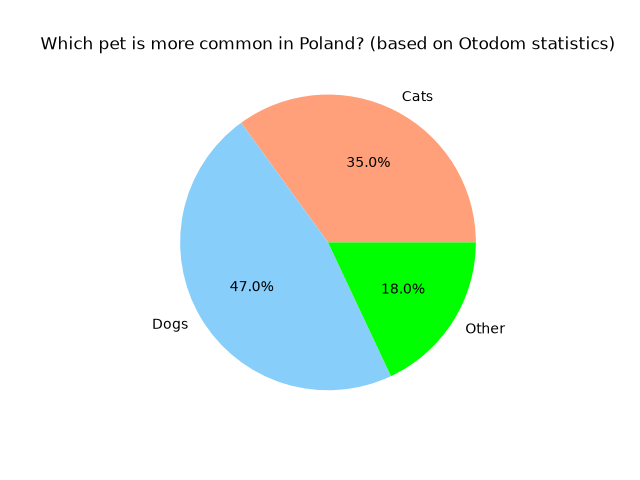

# Pie Chart

Documentation for the `pie` chart module in Analitika.

## Configuration Options

Required fields are **bolded**.

### Top-level configuration (`BaseConfig`)

- **`type`** (`string`) — Chart type selector. Must be set to `"pie"` to use the pie chart module.
- **`module_config`** (`object`) — Object containing the pie chart-specific configuration options described below.

### Module configuration (`PieConfig`)

- **`categories`** (`list[string]`) — Labels for each slice of the pie chart. Each label corresponds to the value at the same index in `values`.
- **`values`** (`list[float]`) — Numeric values determining the size of each slice. The order and length should match `categories`.
- `colors` (`list[string] | null`, optional, default: `null`) — Custom colors for the slices. Accepts any Matplotlib-compatible color format (e.g., CSS color names like `"LightSalmon"`, hex codes like `"#ff6347"`, etc.). When omitted or `null`, Matplotlib's default color cycle is used.
- `title` (`string | null`, optional, default: `null`) — Title displayed at the top of the chart. When omitted or `null`, no title is rendered.
- `value_label` (`string | null`, optional, default: `null`) — Python format string passed to Matplotlib's `autopct` parameter to display percentage labels inside each slice (e.g., `"%1.1f%%"`). When omitted or `null`, no value labels are drawn on the slices.

## Full Configuration Model (JSON)

```json
{
  "type": "pie",
  "module_config": {
    "categories": ["string"],
    "values": [0.0],
    "colors": ["string"],
    "title": "string",
    "value_label": "string"
  }
}
```

## Example

The following [config.json](config.json) demonstrates all available options:

```json
{
  "type": "pie",
  "module_config": {
    "categories": [
      "Cats",
      "Dogs",
      "Other"
    ],
    "values": [
      35.0,
      47.0,
      18.0
    ],
    "title": "Which pet is more common in Poland? (based on Otodom statistics)",
    "value_label": "%1.1f%%",
    "colors": [
      "LightSalmon",
      "LightSkyBlue",
      "Lime"
    ]
  }
}
```

To generate the chart:

```bash
python main.py examples/pie_chart/config.json -o examples/pie_chart/preview.png
```

### Preview


